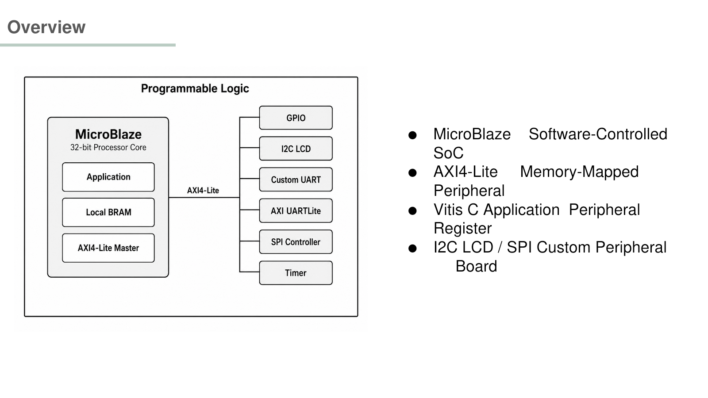
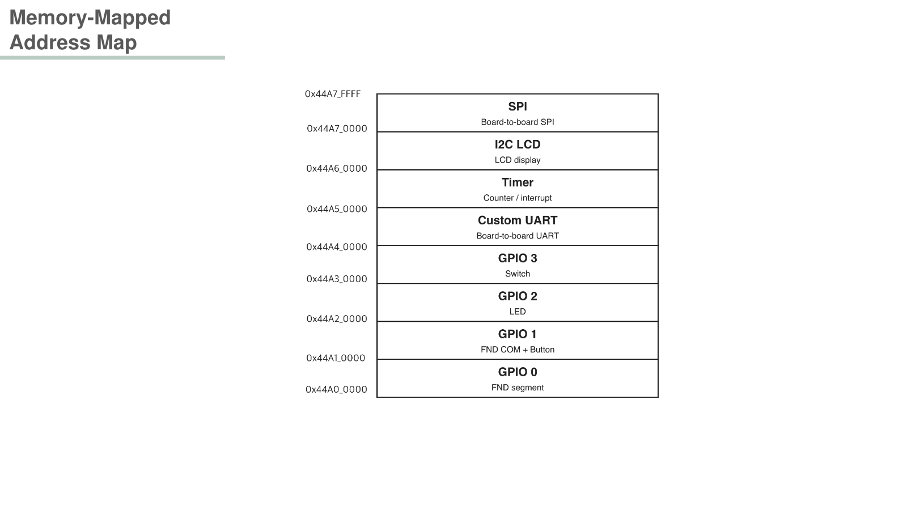
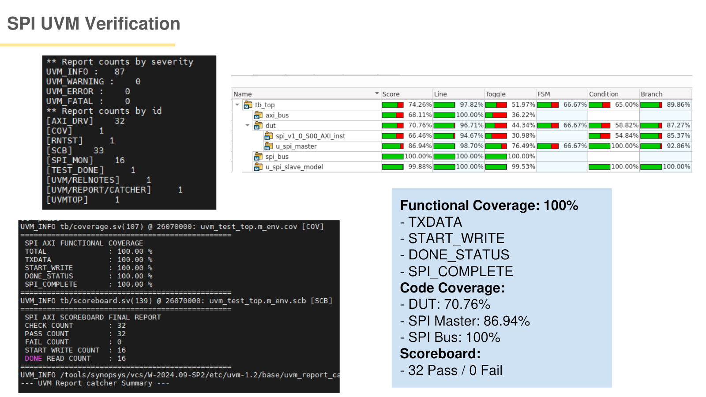
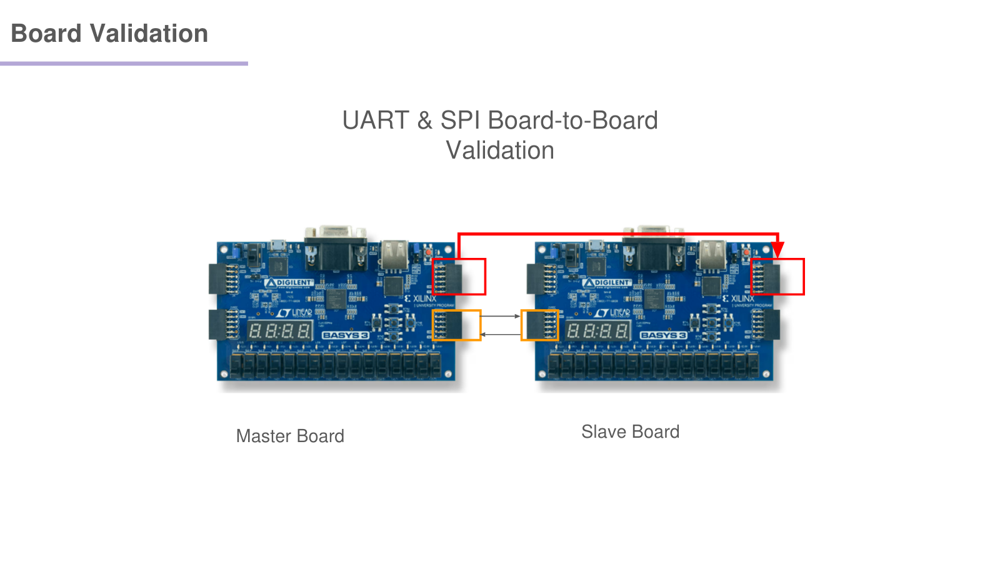

# AXI4-Lite Multi-Peripheral SoC

MicroBlaze와 AXI4-Lite Interconnect를 중심으로 GPIO, UART, Timer, I2C LCD, SPI Peripheral IP를 하나의 FPGA 시스템에 통합한 개인 프로젝트입니다. RTL IP 설계부터 Address Map 구성, MMIO 기반 소프트웨어 연동, UVM 검증, Vivado Synthesis/Implementation, Basys3 보드 검증까지 연결했습니다.



## Project Scope

- **Type:** Individual Project
- **Target:** Digilent Basys3 FPGA
- **Tools:** Vivado 2020.2, Vitis, SystemVerilog/UVM
- **Core:** MicroBlaze + BRAM + AXI Interconnect
- **Peripherals:** GPIO ×4, Custom UART, Timer, I2C LCD, SPI

## My Contributions

- Vivado Block Design에서 MicroBlaze, BRAM, AXI Interconnect 및 Peripheral IP 연결
- AXI4-Lite Address Map과 Custom IP register interface 구성
- GPIO, UART, Timer, I2C LCD, SPI Peripheral RTL 및 Top-level integration
- AXI-Lite transaction 기반 SPI UVM testbench 구성과 scoreboard/coverage 확인
- XDC 제약 작성·수정, Vivado Synthesis와 Implementation 수행
- Vitis C application을 통한 MMIO access 및 HW/SW 연동
- 두 Basys3 보드 사이 UART/SPI 통신 동작 검증

## Architecture

AXI Interconnect의 10개 Master Interface에 Xilinx IP와 Custom Peripheral을 연결했습니다. 각 Custom IP는 AXI4-Lite register interface와 실제 peripheral core로 나뉩니다.

| Address | IP | Role |
|---|---|---|
| `0x0000_0000` | Local BRAM | Instruction/Data memory |
| `0x4060_0000` | AXI UARTLite | Console |
| `0x4120_0000` | AXI Interrupt Controller | Interrupt control |
| `0x44A0_0000`–`0x44A3_0000` | GPIO0–3 | FND, LED, switch I/O |
| `0x44A4_0000` | Custom UART | Board-to-board UART |
| `0x44A5_0000` | Timer | Timer peripheral |
| `0x44A6_0000` | I2C LCD | LCD control |
| `0x44A7_0000` | SPI | Full-duplex SPI transfer |



## RTL and HW/SW Integration

- `hardware/block_design/design_1.bd`: MicroBlaze subsystem과 AXI 연결 정보
- `hardware/ip/`: Custom IP top, AXI slave register block, peripheral core
- `hardware/constraints/`: Master/Slave Basys3 pin constraints
- `software/common/`: MMIO HAL과 공통 GPIO/UART 계층
- `software/integrated_app/`: GPIO, UART, I2C LCD, SPI를 함께 제어하는 Vitis application

소프트웨어는 `Xil_In32`/`Xil_Out32` 기반 MMIO 계층을 통해 각 peripheral register에 접근합니다. Vitis가 생성하는 BSP와 `xparameters.h`는 저장소에 포함하지 않았습니다.

## Verification

AXI-Lite master sequence가 SPI register를 제어하고, SPI monitor와 scoreboard가 MOSI/MISO 및 RXDATA를 비교하도록 UVM 환경을 구성했습니다.

- Scoreboard: **32 Pass / 0 Fail**
- 정의한 Functional Coverage: **100%**
- SPI Bus Coverage: **100%**

위 수치는 이 저장소의 AXI-SPI UVM 환경에서 정의한 검증 항목에 대한 결과입니다.



## FPGA Validation

Vivado Synthesis/Implementation을 거쳐 Basys3에 구현하고 GPIO, UART, I2C LCD, SPI 동작을 확인했습니다. SPI는 두 보드 간 연결을 통해 송수신을 검증했습니다.



## Repository Structure

```text
hardware/       Vivado block design, custom IP RTL, XDC
software/       Vitis C application and MMIO drivers
verification/   SPI/I2C UVM environments
docs/assets/    README images
docs/original/  Original reports, logs, PPTX, schedule
```

Vivado의 `.Xil`, cache, generated output products와 run 결과는 제외했습니다. `design_1.bd`와 RTL/IP source를 기준으로 project와 output products를 재생성해야 합니다.

## Evidence

완료보고서, 개발일지, 발표자료 원본은 [`docs/original`](docs/original)에 보존했습니다.
